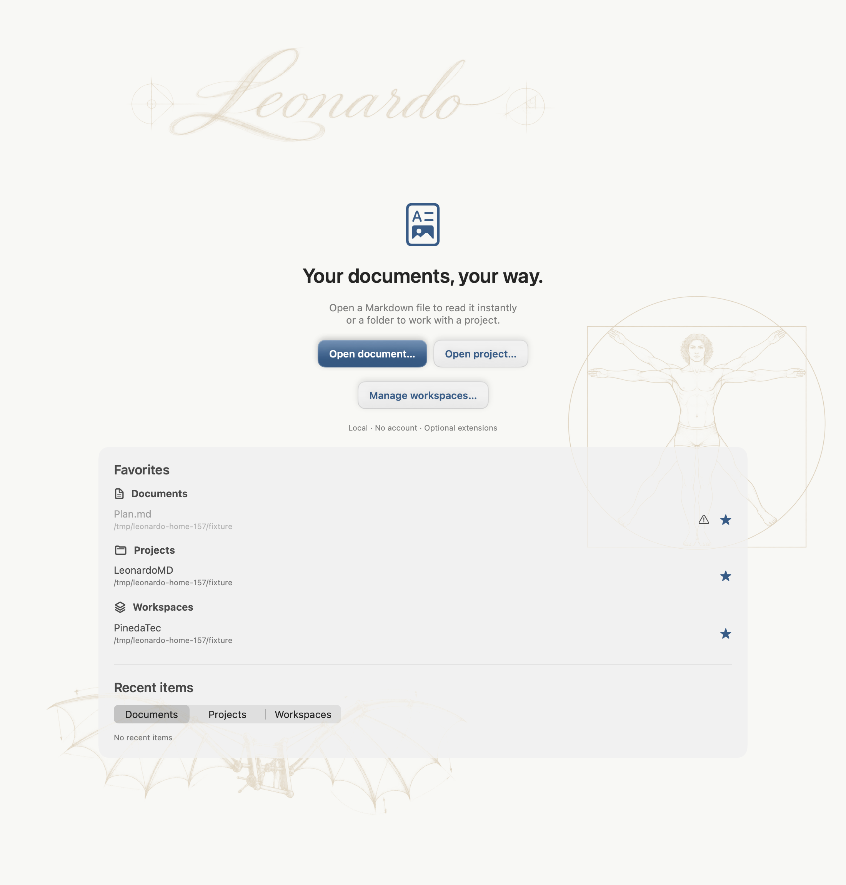

# LeonardoMD

Native macOS Markdown reading and editing, backed by real local files. Open a single document in a clean viewer, or a folder as a project with navigation, search and optional Git. Create and fill structured Leonardo forms while keeping the document body in Markdown.

## Download and install

[**Download the latest stable release**](https://github.com/PinedaTec-EU/LeonardoMD/releases/latest) · [All releases and betas](https://github.com/PinedaTec-EU/LeonardoMD/releases)

Published macOS packages support **Apple Silicon (arm64), macOS 14 or later**, and are **Developer ID signed and notarized by Apple**. Download the `LeonardoMD-<version>.zip` asset, extract it and move `LeonardoMD.app` to Applications. Building from source is optional; no Xcode installation is needed to use the published app.

No account, API key or network connection is needed to read local documents. The interface is available in English and Español.

## Reading and editing

- **Read a document:** open `.md`, `.markdown` or `.txt` directly, including through Finder’s **Open With** menu. No project is required.
- **Work with a folder:** browse and search a project, manage files and folders, or group projects under a workspace.
- **Edit deliberately:** unlock the toolbar padlock, choose Editing or Split, and save with ⌘S. Unsaved changes are marked; closing or navigating away offers Save, Discard or Cancel. Preview synchronization is approximate.
- **Render offline:** bundled resources support code highlighting, relative images and links, tables and tasks. Mermaid and mathematics are disabled by default and can be enabled in **Preferences → Extensions**.
- **Organize and share:** search frontmatter tags with `tag:swift`, export rendered documents to PDF, and choose global or project palettes and paper effects.
- **Use Git optionally:** enable project Git tools to inspect changes, stage, commit and manually fetch, pull or push with existing system credentials. Pull is fast-forward only and protects dirty worktrees.

| Shortcut | Action |
| --- | --- |
| ⌘O | Open document |
| ⇧⌘O | Open project |
| ⌘1 / ⌘2 / ⌘3 | Reading / Editing / Split |
| ⇧⌘F | Focus |
| ⌥⌘I | Document outline |
| ⌘S | Save |
| ⇧⌘E | Export PDF |

See the [user guide](doc/user-guide.md) for document modes, preferences, tags, Git and update behavior.

## Open Leonardo documents and forms

Standard Markdown files keep their normal behavior. Leonardo adds an open document format with a Markdown body and versioned JSON metadata:

| Format | Purpose |
| --- | --- |
| `.mdlf` | Structured document with field, answer and layout metadata |
| `.mdlr` | Form response that opens in Fill form mode |
| `.mdlz` | Ordinary ZIP package containing one MDLF/MDLR document and its local resources |

Forms support declared fields and validation, including saving incomplete drafts. Leonardo metadata also describes backgrounds, image placement and table column widths. Other Markdown viewers can display the Markdown body, but may not interpret Leonardo fields or layout.

The optional [table-width directive](doc/table-widths.md) also works in ordinary Markdown: other viewers ignore its HTML comment and render the standard table.

Explore the [format specification, schema and examples](doc/format/README.md), or use the [Codex/Claude plugin and MDLZ generation guide](doc/plugins/leonardo-format.md).

## Updates

Published macOS builds include an updater. In **Preferences → Updates**, choose Stable or Beta, check manually or enable periodic checks. Stable is selected initially; beta participation is explicit. Installation requires user action, and switching to Stable never downgrades an installed beta.

[Release notes and downloads](https://github.com/PinedaTec-EU/LeonardoMD/releases) identify each published package. See the [user guide](doc/user-guide.md#updates) for channel behavior and legacy beta recovery.

## Little Leonardo for iPhone and iPad

This repository also contains the native **Little Leonardo** companion in `Mobile/LittleLeonardo.xcodeproj`, targeting iOS 17 or later. It supports authorized desktop document access with offline reading, and a Git workflow for editing selected project content. Direct mobile synchronization is read-only; desktop peer synchronization supports editing with manual reconciliation.

The macOS ZIP does not install the iOS app. See [Little Leonardo](doc/mobile/little-leonardo.md) for build instructions, pairing, synchronization contracts and validation limits.

## Development and documentation

The Swift package separates `LeonardoCore`, `LeonardoRender` and `LeonardoApp`, with shared synchronization components and a separate iOS target.

- [Build, test, startup diagnostics and native QA](doc/development.md)
- [Signed release preparation and distribution validation](doc/releases.md)
- [Release version ledger](doc/release-version-ledger.md)
- [Localization](doc/localization.md)
- [Product stories](doc/US) and [architecture decisions](doc/adr)
- [Sample project](Examples/Proyecto)

LeonardoMD is distributed under the [MIT license](LICENSE).
