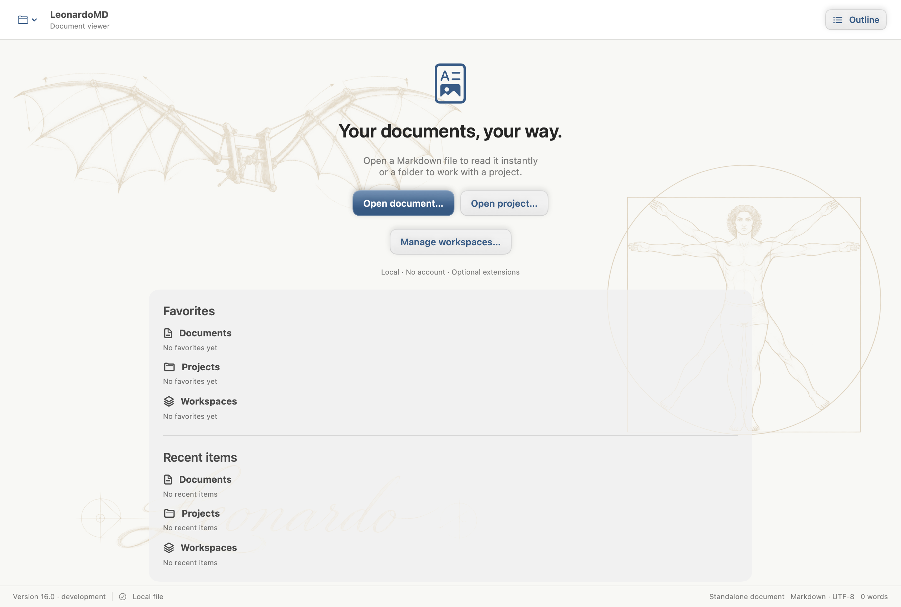
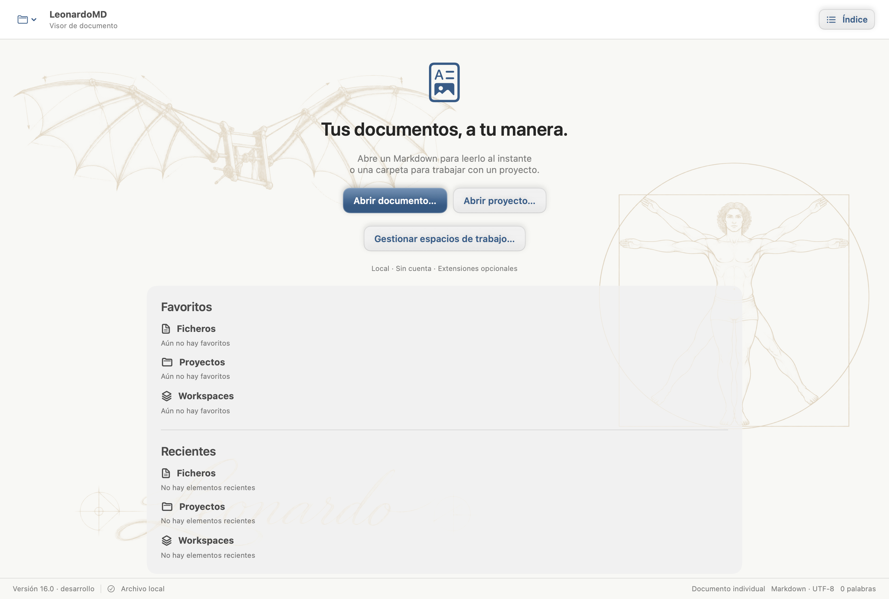
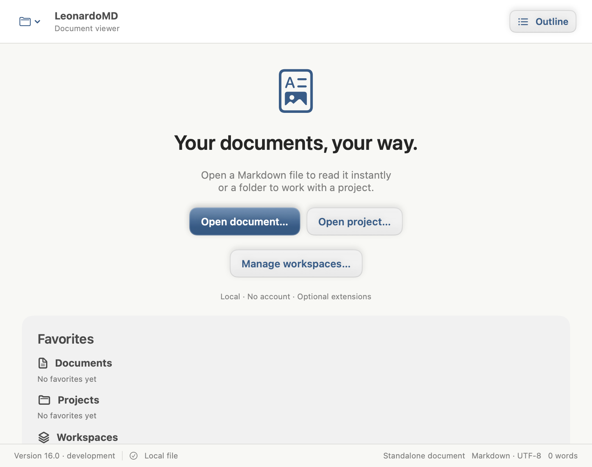
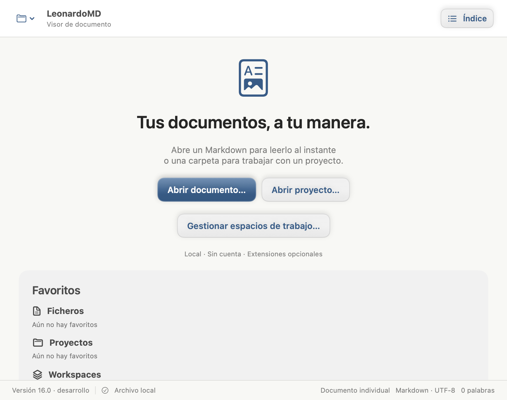

# Application identity native captures

Author-owned AppKit/SwiftUI captures from `LocalizationVisualTests.testCaptureApplicationIdentityInBothLanguages`, using the real AboutWindow and WorkspaceView with an isolated synthetic AppSession. Browser: not applicable (native macOS). About: 720×580 points; workspace: 1260×850 and 760×600 points, at 2× scale. Both English and Spanish are captured.

Reproduce from the PR checkout after compilation:

```bash
LEONARDO_LOCALIZATION_EVIDENCE=/tmp/leonardo-identity swift test --skip-build --filter LocalizationVisualTests/testCaptureApplicationIdentityInBothLanguages
```

The XCTest runner bundle reports version 16.0 and has no distribution channel: these captures deliberately show its development fallback. `ApplicationVersionTests` separately verifies numeric product versions and stable/beta/future installed channels; these images do not claim a packaged beta or fresh application startup. The owner excluded local installation and the existing app retains single-instance ownership. Capture provenance and exact reviewed SHA are recorded on PR #143.

| Surface | English | Spanish |
| --- | --- | --- |
| About |  |  |
| Workspace |  |  |
| Narrow workspace |  |  |
