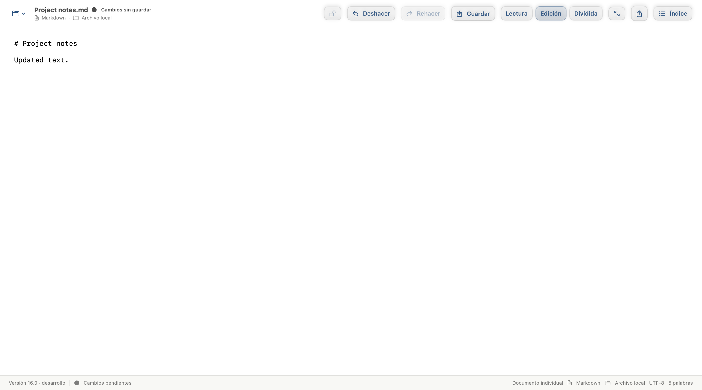
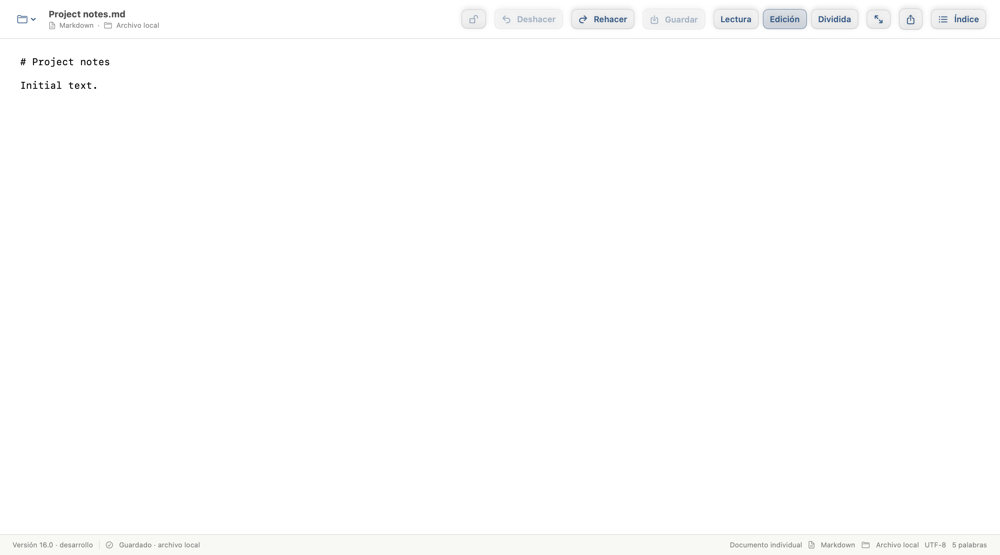

# Document Undo and Redo

Tracking: [issue #230](https://github.com/PinedaTec-EU/LeonardoMD/issues/230), [PR #231](https://github.com/PinedaTec-EU/LeonardoMD/pull/231).

The document toolbar and Edit menu expose Undo (⌘Z) and Redo (⇧⌘Z). Source, editable preview and form edits share one session history. A new edit clears Redo. History retains the latest 200 edits and lasts for the current document in the current session; it is not persisted across app restarts.

Source undo requires writable access. Form undo requires Fill mode, including when the source remains protected. Busy, closing, saving, reconciliation and preview capture states preserve the editing authorization gates. Unrelated native text controls, such as search fields, retain their own native undo. The source editor uses the document history instead of a second native stack.

Saving the same content format preserves history and updates the dirty baseline: undoing a saved change makes the buffer dirty without writing the file, and redoing it returns to the saved state. Loading, reloading, discarding, changing document identity, or replacing the buffer outside an ordinary edit clears history. Format migration replaces the buffer and resets history, including migration enabled through Save; history never reintroduces Markdown into a migrated MDLF identity.

## Validation

On 2026-10-20 the full local suite passed 527 XCTest cases (19 optional skips) and 26 Swift Testing cases. The final focused rerun passed seven history tests, including the native captures. Four successful compilation commands are recorded in `deploy/version/entries/231.yaml`.





`DocumentEditHistoryTests` covers undo/redo chains, stale edits, redo invalidation, protection and lifecycle gates, session isolation, buffer replacement, identity changes, save baseline, form authorization, no-op edits and the history bound.

The opt-in native capture test uses the real `WorkspaceView` in an XCTest-hosted AppKit window with synthetic content, in Spanish, at 1440×800 points. It captures Undo available after an edit and Redo available after Undo. These are component captures, not proof of startup of a freshly packaged process.

```sh
LEONARDO_UNDO_EVIDENCE="$PWD/doc/validation/document-undo" python3 scripts/compile-and-record.py --pr-number 231 -- swift test
```
