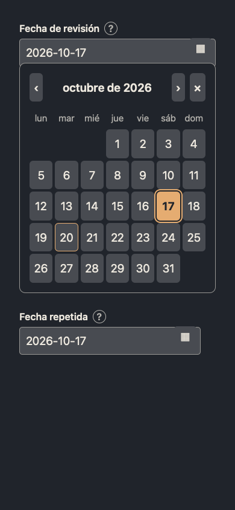

# Form calendar validation

Tracking: [#232](https://github.com/PinedaTec-EU/LeonardoMD/issues/232).

## Reproduce the renderer preview

From the PR checkout, run `python3 -m http.server 8933 --bind 127.0.0.1` and open `http://127.0.0.1:8933/doc/validation/form-calendar/preview.html`. Add `?theme=dark` for dark mode. The fixture references the actual bundled form/calendar JavaScript and CSS directly, with synthetic data and Spanish locale. It opens the calendar with October 17, 2026 selected and exposes a duplicate date field for synchronization checks. The exact reviewed SHA and capture binding are recorded in the PR evidence comment.

Implementation-owned captures made on 2026-10-20 in Playwright WebKit:

- `light.png`: 1280 × 720, warm document palette, selected day focused.
- `dark.png`: 1280 × 720, dark document palette, selected day focused.
- `narrow.png`: 390 × 844, dark document palette; document scroll width and viewport both 390px, calendar width 326px.

These are actual renderer fixture captures, not packaged macOS application captures. The fixture supplies palette tokens rather than changing the installed app. This change affects bundled form resources and their registration; no app startup or packaging code changes. No installed app was replaced or terminated.

The calendar expands in document flow to avoid clipping inside authored tables. It uses a 26em preferred width constrained by available space; day targets scale with document text. ISO date text remains editable so incomplete drafts are preserved.

`FormCalendarTests` loads the actual bundled shell in a real WKWebView. It verifies leap-year month length, arrow navigation across months, date selection and snapshot, duplicate-field synchronization, incomplete draft preservation, active theme background, Escape dismissal, export suppression disabled Preview controls and safe English fallback/selection for malformed document locale tags, plus Gregorian month/day labels even when a locale requests another calendar. The existing `InlineFormTests` covers save, reopen and export through the app controller.




## Pointer regression

With the preview server above running and the Playwright CLI/browser installed, run:

```sh
python3 doc/validation/form-calendar/check-pointer.py --cli "$HOME/.codex/skills/playwright/scripts/playwright_cli.sh" --browser webkit
```

Repeat with `--browser msedge` to check Edge. The script uses real pointer activation for next/previous month, date selection, repeated-field synchronization, reopening and outside dismissal; it then verifies keyboard navigation and Escape still work. It closes its own browser session and keeps scratch files in a disposable directory. Programmatic DOM `element.click()` alone does not exercise this regression.

The native `testBlurBeforePointerActivationDoesNotDismissInsideControls` covers the preceding blur across separate WebKit tasks and outside focus dismissal. Calendar dismissal tracks actual outside pointer/focus targets rather than the transient active element during blur. The pointer script fails against pre-fix head `628d257` with `Pointer next month failed`, and passes with the correction in both WebKit and Edge.
