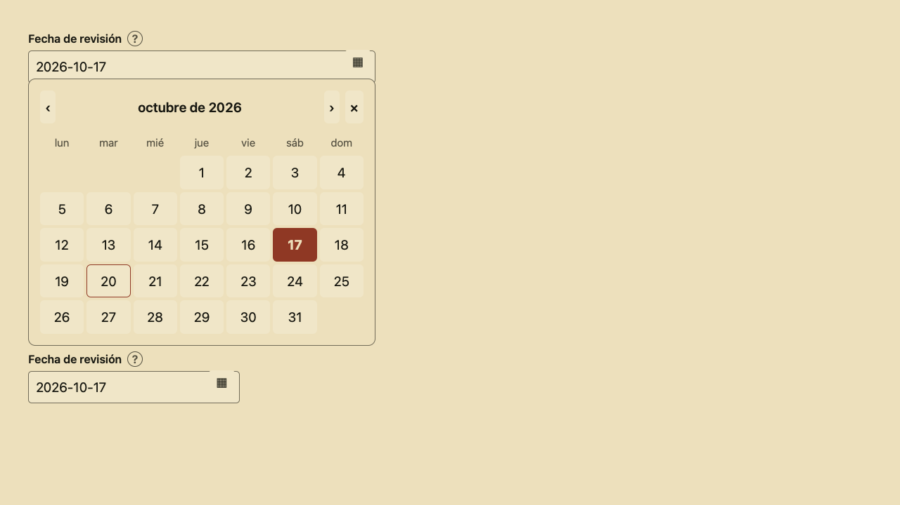
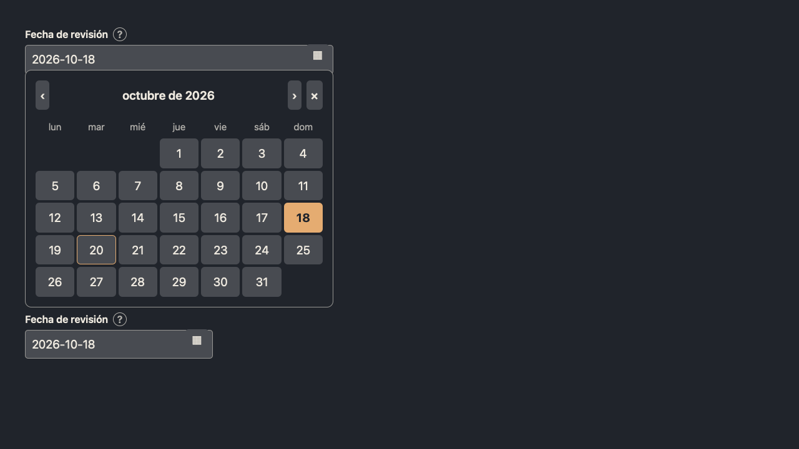

# Form calendar validation

Tracking: [#232](https://github.com/PinedaTec-EU/LeonardoMD/issues/232).

The two captures show the actual bundled form/calendar JavaScript and CSS in a synthetic isolated HTML fixture served at localhost:8932 using Playwright WebKit, 1280 × 720, Spanish locale, on 2026-10-20. These are renderer fixture captures, not captures of the packaged macOS application. Warm and dark palettes are supplied through the same `--ld-background`, `--ld-text` and `--ld-accent` tokens used by the document renderer. The later resource-loading correction affects the native HTML shell, not these captured assets.

The calendar expands in document flow to avoid clipping inside authored tables. It uses a 26em preferred width constrained by available space; day targets scale with document text. ISO date text remains editable so incomplete drafts are preserved.

`FormCalendarTests` loads the actual bundled shell in a real WKWebView. It verifies leap-year month length, arrow navigation across months, date selection and snapshot, duplicate-field synchronization, incomplete draft preservation, active theme background, Escape dismissal and export suppression. The existing `InlineFormTests` covers save, reopen and export through the app controller.

Native packaged-app visual acceptance and independent PR judgment remain pending. No installed app was replaced or terminated.

