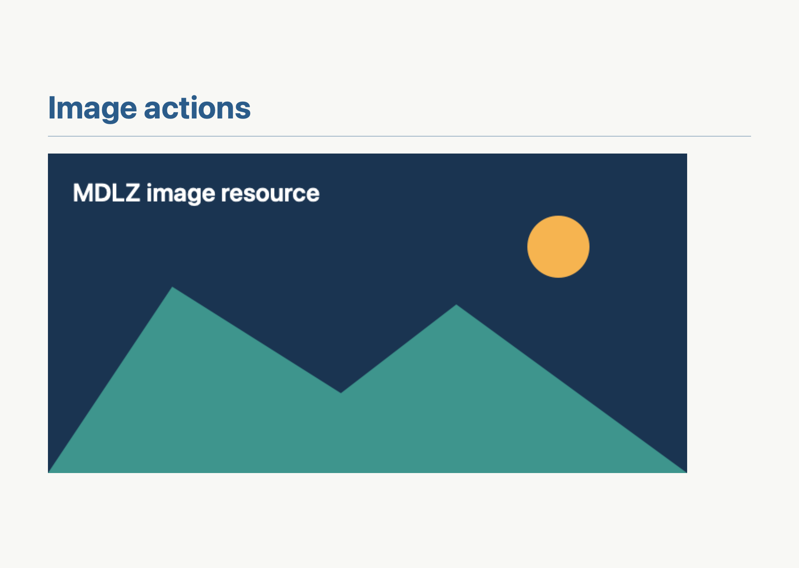
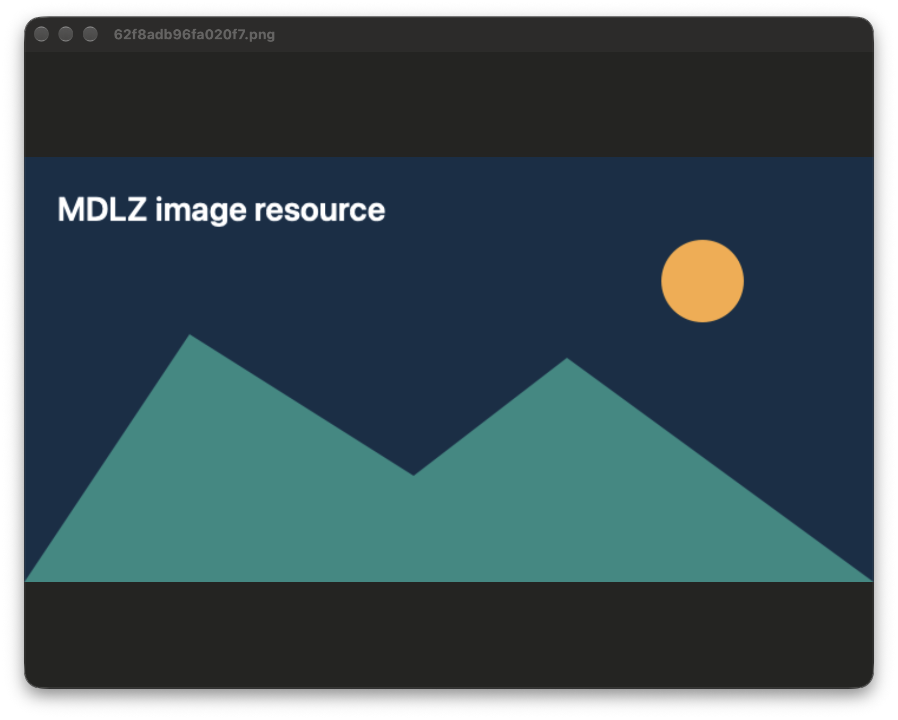
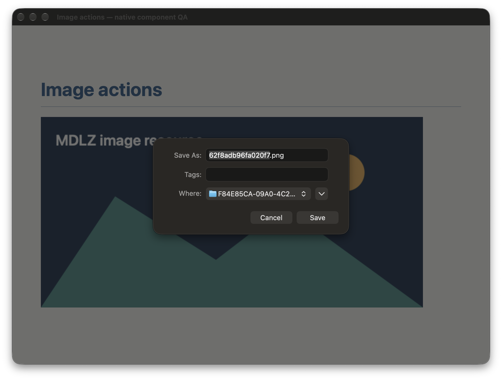

# Native image context actions

Tracking: [#295](https://github.com/PinedaTec-EU/LeonardoMD/issues/295).

## Verified behavior

`MarkdownImageContextVisualTests` creates and opens a real MDLZ containing a
synthetic PNG, loads its extracted document in the production preview host,
and invokes the native menu routes. It verifies a visible image window,
visible native save sheet, byte-identical output from the production completion,
and cancellation without file mutations. Native Copy Image keeps its original
WebKit menu item, covered by `MarkdownImageActionsTests`.

The save directory is configured before presentation via the native panel
factory. The integration test drives AppKit’s supported sheet completion;
it does not claim an accessibility click on the remote Save button. No standalone
XCTest executable was packaged or launched as an app. No packaged product
startup or installed-app upgrade is claimed.

## Reproduce

From the reviewed checkout, after a recorded compilation:

```sh
CFFIXED_USER_HOME=/tmp/leonardo-296-test-home \
LEONARDO_IMAGE_EVIDENCE=/tmp/leonardo-296-evidence \
swift test --skip-build --filter MarkdownImageContextVisualTests
```

Use `python3 scripts/compile-and-record.py --pr-number 296 -- swift test`
when recompilation is required. The test output directory contains original PNGs
and observed context JSON. Native window capture requires screen-recording access.
Browser URL, CSS viewport and browser version are not applicable to the native
AppKit window and sheet. The preview is a real WKWebView in an XCTest-owned
component window, not a browser-hosted clone.

## Capture provenance

Capture/build source: `72ccdfbd7249f6bd5d0f8345b5c580be1f0d7567`.
The exact committed source was rerun with `--skip-build` before capturing.
The following evidence-only commit adds these captures and this document;
product source, test source, manifests and the compilation ledger are unchanged.
Verify that mapping with `git diff 72ccdfbd7249f6bd5d0f8345b5c580be1f0d7567 HEAD -- Sources Tests Package.swift Package.resolved deploy/version`.

Native preview: 900 × 640 points; image window content: 800 × 600 points.
The save-sheet capture includes its 900 × 640-point parent preview. PNGs of
native windows also include title bars/shadows; the generated sidecars record
actual pixel dimensions, native viewport values, capture time and SHA-256.






