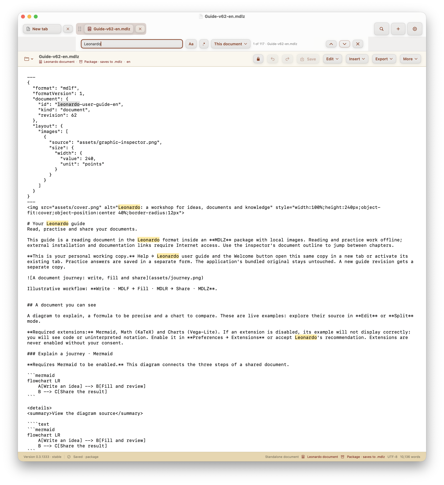

# In-editor search and packaged Help acceptance

Acceptance evidence for [#39](https://github.com/PinedaTec-EU/LeonardoMD/issues/39)
and [#434](https://github.com/PinedaTec-EU/LeonardoMD/issues/434), recorded on
2026-11-12 in the real macOS QA application.

## Tested instance

- Product: LeonardoMD `0.3.1333` stable, build `1333`.
- QA process: PID `72624`, launched with `--new-instance`.
- QA bundle identifier: `eu.pinedatec.LeonardoMD.qa.5a8aa4a28bbf4fc3ad5d2584633f108b`.
- Executable: `LeonardoMD` from the disposable `LeonardoMDQA.app` created by
  `./launch.sh --qa`; bundle verification passed and `otool -L` showed no
  XCTest linkage.
- Profile: isolated `CFFIXED_USER_HOME=/tmp/leonardo-qa-v62/home`.
- App interface locale: English. Both packaged Help locales were opened through
  the actual Help workflow in this process: `Guide-v62-en.mdlz` and
  `Guide-v62-es.mdlz`.
- Extensions while reviewing both guides: Mermaid, Math and Charts enabled;
  Citations and Markdown extras disabled. Math was temporarily disabled to
  inspect its fallback, then restored to enabled.
- Search implementation revision: `c38d821f`. The disposable app included
  the Guide v62 packages and their resource-path updates from PR head
  `a18fe1eb`; the successful build was recorded in PR #40's compilation
  delta.

## Search interaction

The window contained the English and Spanish guide tabs. Search was entered
from the document toolbar and used the window-wide scope:

- Literal `Leonardo`, case-insensitive, all open documents: **237 matches**.
- The same literal with Match case enabled, all open documents: **200 matches**.
- With Match case enabled and This document selected on the English guide:
  **99 matches** (the case-insensitive English-only count was **117**).
- Regex `\b(Leonardo|documento)\b`, all open documents: **270 matches**.
- A malformed regex (`(`) displayed **Invalid regular expression** and disabled
  previous/next navigation.
- Next/previous moved to the matching guide tab and selected its occurrence.
  Previous from the first result wrapped to `270 of 270` in the English guide.
- The visible search UI showed highlighted occurrences and a distinct current
  match. The accessibility tree reported the search field, toggles, scope,
  result count, active tab and navigation controls.

## Packaged Help and practice form

Both revision-62 guides were opened in this same process using Help. The native
accessibility tree exposed the local cover and illustration images, Mermaid
diagram, chart image, tables, and rendered inline and display equations. With
Math enabled, the one-line equation, underbrace examples, radical/arrow/cancel
example and the tagged box-counting equation `(1)` appeared as equation nodes;
the tagged expression did not expose literal delimiters or a KaTeX error.

With Math temporarily disabled, the one-line and multiline `$$` formulas and
TeX commands appeared as source notation in Preview. The BibTeX code example
remained literal. Math was re-enabled afterwards. The English practice form was
opened from chapter 4 of the packaged guide, edited with fictional values,
saved with ⌘S, closed, and reopened from the guide. The saved name, goal and
checkbox state were present after reopening.

## Visual evidence

The fresh QA process PID `38064` displayed the English Guide v62 in its native
window with the literal query `Leonardo`, **This document** scope, and
case-insensitive matching. The captured state shows `1 of 117`, the previous
and next controls, and yellow occurrence highlights in the guide source.

The original window capture and its metadata are in
[`search-in-guide-v62-en.png`](search-in-guide-v62-en.png) and
[`search-in-guide-v62-en.capture.json`](search-in-guide-v62-en.capture.json).
The capture is from the real QA application, version `0.3.1333` stable, build
`1333`, bundle `eu.pinedatec.LeonardoMD.qa.5a8aa4a28bbf4fc3ad5d2584633f108b`.
The app was running the search implementation from `c38d821f` with the Guide
v62 packages and resource paths from `a18fe1eb`.

This is a native macOS window capture. The shared browser metadata helper
requires a browser version and CSS viewport, which the native host does not
expose; neither is fabricated here. The adjacent native sidecar records the
observed AppKit window/content dimensions and explicitly marks browser/CSS
fields as not applicable. The screen shows bundled, product-authored help and
no user-authored document content.
