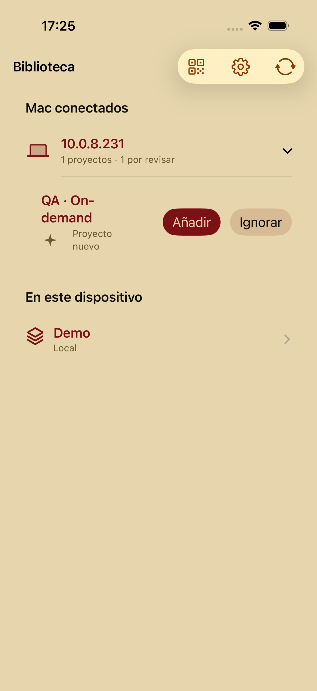
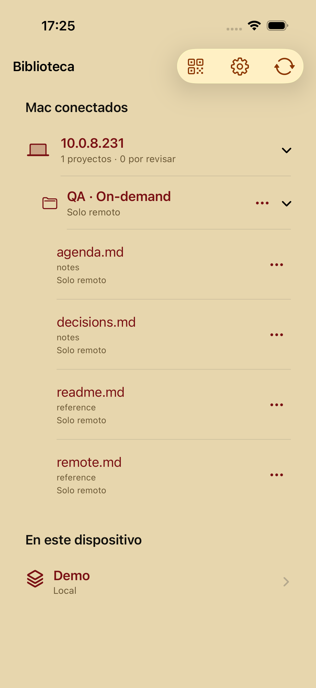
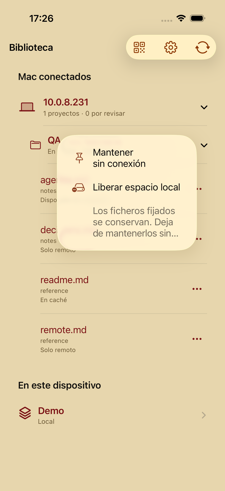
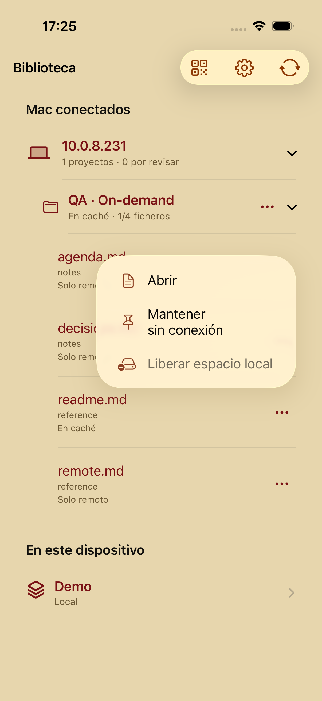
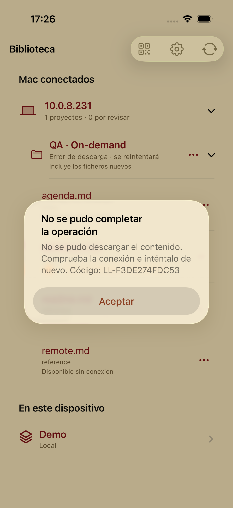
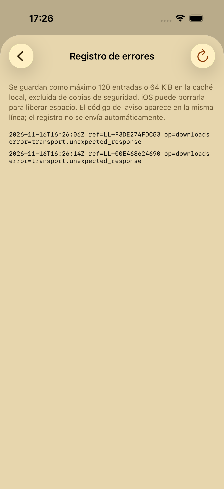

# Combined-source Spanish Little Leonardo acceptance

Captured 2026-11-16 from `OnDemandSyncUITests/testCatalogueContextRetentionAndSeparateCache()` on iPhone 17 Pro / iOS Simulator 26.5 (`23F77`). Synthetic host fixture only.

- Product source: `3bac17a09149571ac425ef83e5f2fcfdca5e427d` (includes #458).
- Test and fixture source: `fc607375e9412dc267034cc8e651a685bd348fbb` (#460). Documentation-only PR head at test time: `0b611957afd07de59489d3331ca6c81100e9e892`.
- Result: 1 passed, 0 failed, 0 skipped (153.827 s). Xcode result: `/Users/jmr.pineda/Library/Developer/XcodeBuildMCP/workspaces/LeonardoMD-586d26453937/result-bundles/test_sim_2026-11-16T16-24-37-659Z_pid23125_0ccbc608.xcresult`.
- The first attempt reused a prior test container and failed before adding the incoming project. After erasing the dedicated QA simulator and starting a fresh fixture root, the same test passed end to end.
- The successful test shows Add/Ignore for a new project, the `>` project/file hierarchy, file cache controls, project offline retention, localized download failure, and the matching local log. See the original XCTest attachments and sidecars below.
- Fixture audit: catalogue requests `2`, full snapshots `0`; files fetched once each for agenda, future, opened reference and retained remote reference. The rejected file was retried three times only through its explicit flow. The exact audit JSON is adjacent.
- The simulator was shut down after the test; no task-owned app remains running. Other booted simulators and their app processes were preserved.

The connected-host count remains tracked by [#457](https://github.com/PinedaTec-EU/LeonardoMD/issues/457). This simulator evidence makes no physical-device or production-network claim.

## Selected captures

| Screen | Capture |
|---|---|
| Incoming project |  |
| Expanded project catalogue |  |
| Project offline menu |  |
| File cache menu |  |
| Download error |  |
| Matching diagnostic entry |  |
