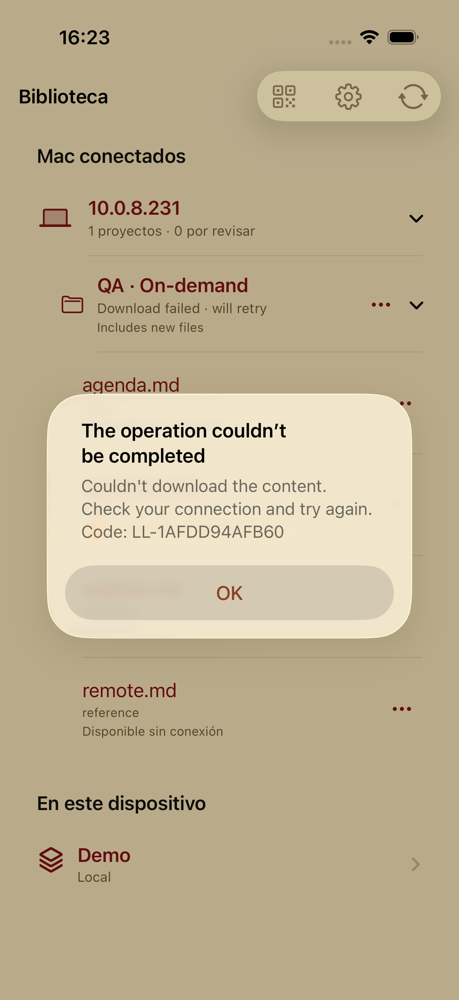
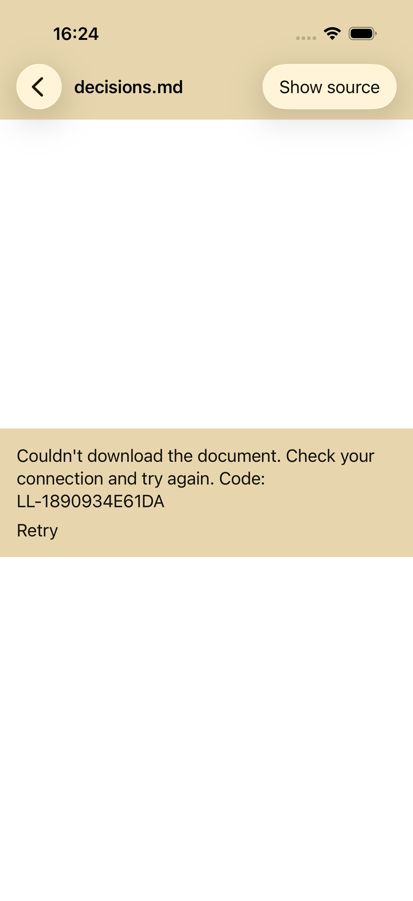
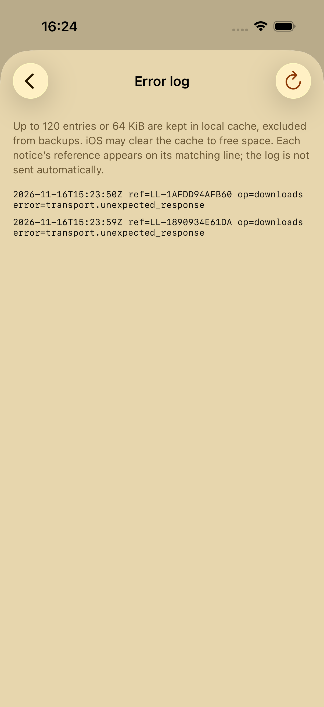
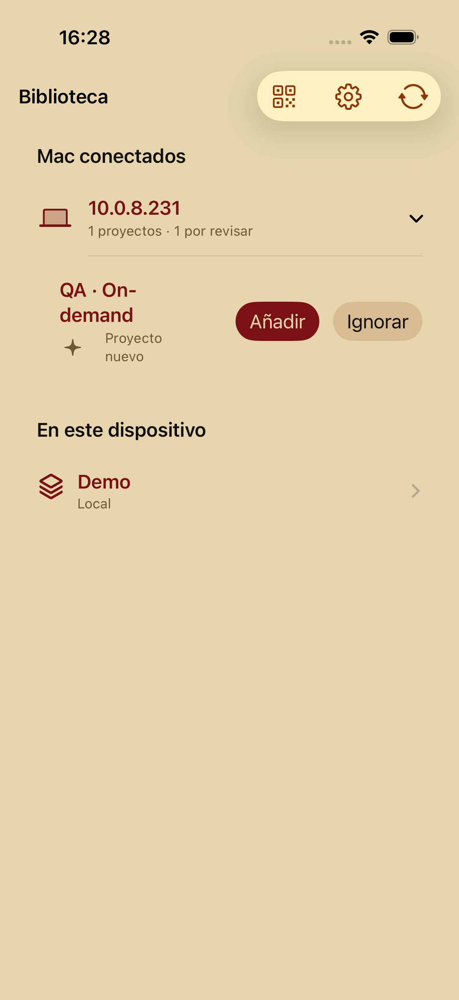
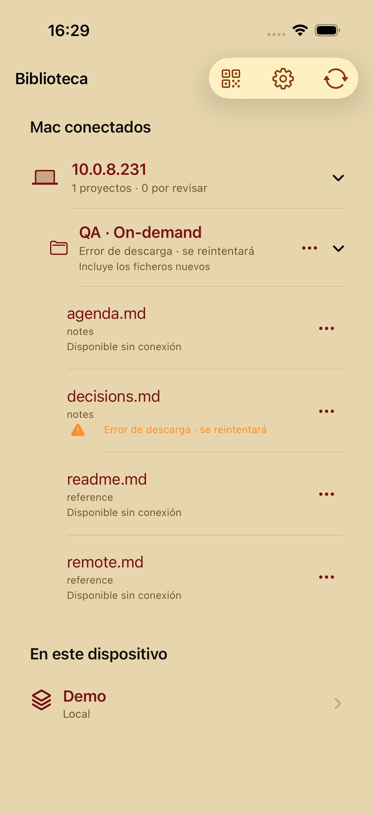
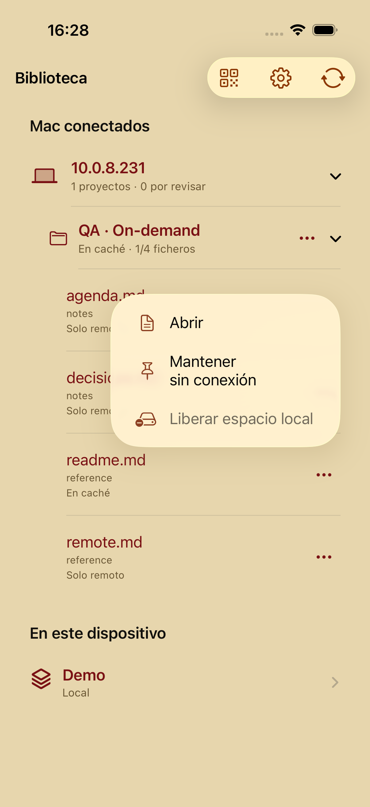
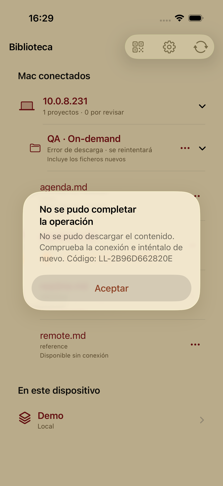
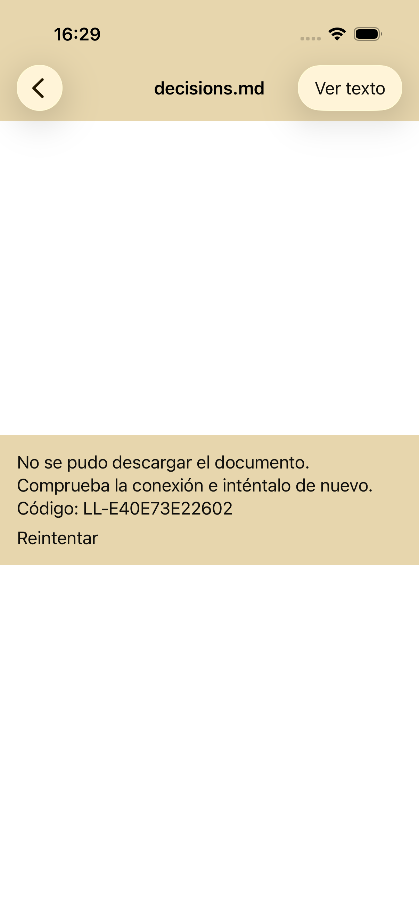

# PR #435 bilingual iOS simulator evidence

Captured 2026-11-16 from Little Leonardo UI tests on iPhone 17 Pro / iOS
Simulator 26.5. All fixture content is synthetic. The product code under test
is `49052f4d4bb2b1bdaabf3bd023e01a185976445e`; the exact simulator test and
fixture source is `5d99fbfe4e8ba46690e3be2db0f305c2dfd5176a` (Git tree
`ba1ea374fff177eba52d96ba78048b82f1cd2061`). The latter makes the Mac fixture
host configurable and ensures the UI test reads the same host written to
`ready.json`.

The project-level offline-retention caption is localized as **Includes new
files** / **Incluye los ficheros nuevos**. The connected-host summary count
still uses Spanish in the English view and remains scoped to [#457](https://github.com/PinedaTec-EU/LeonardoMD/issues/457); it is not claimed as fixed here.

## Build and validation

- Successful simulator build recorded by `scripts/compile-and-record.py` as
  PR compilation delta `114`; no later compilation is included in this record.
- Build command: `xcodebuild -project Mobile/LittleLeonardo.xcodeproj -scheme LittleLeonardo -destination 'platform=iOS Simulator,id=E0777566-9261-4AF7-ACEA-7AA19704B3ED' -derivedDataPath DerivedData -parallel-testing-enabled NO CODE_SIGNING_ALLOWED=YES CODE_SIGN_IDENTITY=- build-for-testing`.
- The simulator app was ad-hoc signed because pairing persists a credential in
  Keychain. The initial unsigned local build failed before sync with
  `credential_storage` / `-34018`; the signed build and tests below passed.
- `.xctestrun`: `/private/tmp/ll-pr435-evidence-20261116/DerivedData/Build/Products/LittleLeonardo_iphonesimulator27.1-arm64.xctestrun`.
- English result bundle:
  `/Users/jmr.pineda/Library/Developer/XcodeBuildMCP/workspaces/LeonardoMD-586d26453937/result-bundles/test_sim_2026-11-16T15-23-24-420Z_pid23125_f75ce010.xcresult`.
- Spanish result bundle:
  `/Users/jmr.pineda/Library/Developer/XcodeBuildMCP/workspaces/LeonardoMD-586d26453937/result-bundles/test_sim_2026-11-16T15-27-49-226Z_pid23125_47efc385.xcresult`.

| Locale | Test | Result | Simulator |
|---|---|---|---|
| English | `OnDemandSyncUITests/testEnglishSharedDownloadFailureLocalizesVoiceOverCopy()` | 1 passed, 0 failed, 0 skipped; 46.845 s | `E0777566-9261-4AF7-ACEA-7AA19704B3ED`, iPhone 17 Pro, iOS 26.5 / `23F77` |
| Spanish | `OnDemandSyncUITests/testCatalogueContextRetentionAndSeparateCache()` | 1 passed, 0 failed, 0 skipped; 122.382 s | `B0E7EEDB-5A14-46D6-B662-FDD6B479B9E6`, iPhone 17 Pro, iOS 26.5 / `23F77` |

Both simulators used a 402 × 874 native-point viewport (1206 × 2622 pixels).
These are native SwiftUI/WKWebView application screens, not browser captures;
the WKWebView engine version is not exposed by the XCTest capture API. Routes,
state, timestamps, source SHA and provenance are recorded in each adjacent
`.context.json` file.

The Spanish test exercised the connected-host → project → file hierarchy,
incoming-project Add/Ignore flow, project and file context menus, project
offline retention, file-level cache release, localized file and project
failures, matching local diagnostics, refresh/recovery, and a file added after
retention. The English test checked the localized project and file failure
status, concise alert, reference code and matching local diagnostic.

Fixture audit JSON confirms that reading the catalogue downloaded no file
bodies, opening one file downloaded only that file, and project-level retention
downloaded the selected files without transferring a whole snapshot. The
English and Spanish audit files and XCTest attachment exports are included
beside this README.

## Selected original captures

The screenshots below are original XCTest attachments; no image pixels were
edited. The manifest lists the SHA-256, capture sidecar and attachment ID for
every PNG in this bundle.

| Screen | Capture |
|---|---|
| English project download alert |  |
| English inline document failure |  |
| English local log correlation |  |
| Spanish newly shared project |  |
| Spanish project context menu and retention caption |  |
| Spanish file context menu |  |
| Spanish project download alert |  |
| Spanish inline document failure |  |

## Test-environment retries and teardown

- The first loopback attempt at `127.0.0.1:46987` did not reach the Mac from
  this simulator. The fixture was rerun on its reachable Mac interface; the
  host was written to `ready.json` and read from that same file by the UI test.
  This test-harness correction is [#460](https://github.com/PinedaTec-EU/LeonardoMD/issues/460), not a production networking change.
- A first Spanish install attempt stopped before XCTest because CoreSimulator
  could not find its placeholder promise. After booting only that task-owned
  simulator, the retry completed successfully.
- The English QA simulator was shut down after capture, followed by the Spanish
  QA simulator. Both exact device IDs now report `Shutdown`. The task's Little
  Leonardo process was absent; a pre-existing app process in simulator
  `E2045815-8A83-4B25-AFD4-1CC7C573BE7E` was preserved. The fixture listener on
  port `46987` was closed. Other pre-existing simulators were left running.
- This does not claim physical-device, camera-scan, or large-image transfer
  acceptance. The owner's large-image failure remains open under [#380](https://github.com/PinedaTec-EU/LeonardoMD/issues/380).
