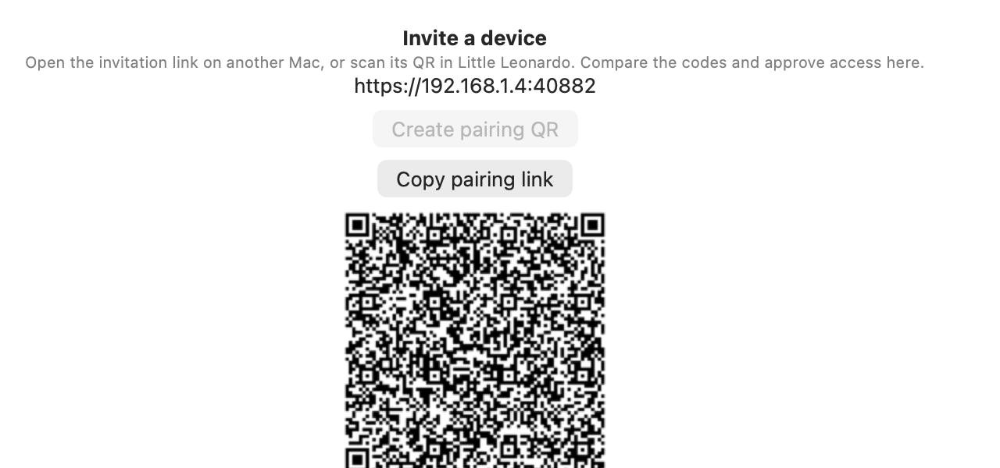
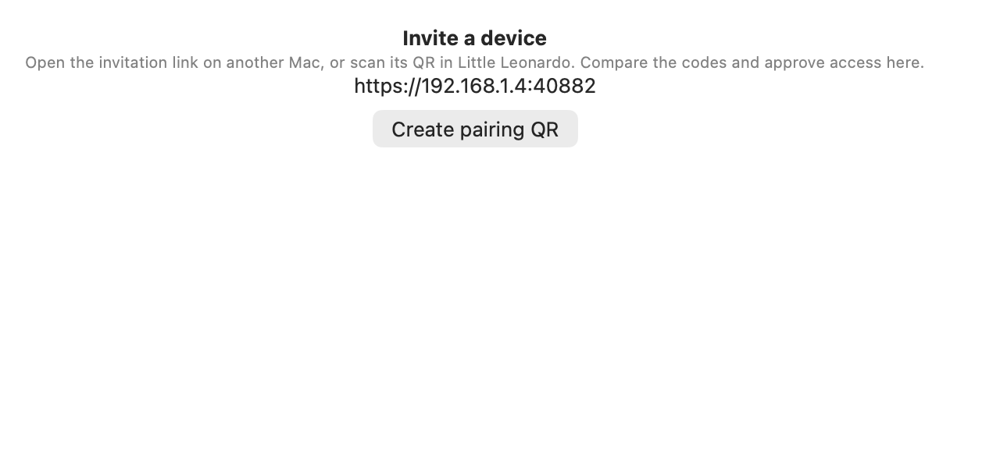

# Pairing invitation recovery evidence — v38

These native AppKit/SwiftUI captures were produced by
`SyncHelperControllerTests.testRecoveredHelperRestartClearsInvalidatedInvitationAtSameEndpoint`
from source commit `639ae581d97a946d3f34507a0995200f20a700c6`. The screenshots
show the updated production pairing view in English and Spanish, with synthetic
network and invitation data. They are component captures, not packaged-beta UI
acceptance.

The first state keeps the last confirmed QR visible while helper health is
still being checked. After the same-endpoint helper restart, the live pairing
registry has invalidated that invitation and the view removes the QR. The
controller test asserts both states. Each image is 640×300 native points
(1280×600 pixels); context and metadata sidecars bind the capture to the source
SHA and image hash.

## Validation

- `SyncHelperControllerTests`: 127 tests, one opt-in capture skipped, zero
  failures.
- Full `swift test --disable-automatic-resolution --skip-build -q`: 506 XCTest
  cases, 35 optional skips, zero failures; 44 Swift Testing cases and 28 package
  tests passed.
- Successful compile recorded build delta `177` in `deploy/version/entries/428.yaml`.
- The targeted recovery capture test passed against source SHA
  `639ae581d97a946d3f34507a0995200f20a700c6`.

| State | Language | Evidence |
| --- | --- | --- |
| Valid QR retained while recovery is pending | English | [PNG](./pairing-valid-qr-retained-during-recovery-en.png) · [context](./pairing-valid-qr-retained-during-recovery-en.context.json) · [metadata](./pairing-valid-qr-retained-during-recovery-en.metadata.json) · SHA-256 `d2959f5653145508d0afacd22bd0697809e17027b48218be8c3970d233023ee0` |
| Valid QR retained while recovery is pending | Spanish | [PNG](./pairing-valid-qr-retained-during-recovery-es.png) · [context](./pairing-valid-qr-retained-during-recovery-es.context.json) · [metadata](./pairing-valid-qr-retained-during-recovery-es.metadata.json) · SHA-256 `b323e04a75648376e8d7385a5f99c8b92abd69346cb59f31066ab6d8c2bbffd4` |
| Invalidated QR removed after helper restart | English | [PNG](./pairing-invalidated-qr-removed-after-restart-en.png) · [context](./pairing-invalidated-qr-removed-after-restart-en.context.json) · [metadata](./pairing-invalidated-qr-removed-after-restart-en.metadata.json) · SHA-256 `caf4492dba87912046cd842a628f4d9f99bf7df65466802e4b7b37e1542d20c5` |
| Invalidated QR removed after helper restart | Spanish | [PNG](./pairing-invalidated-qr-removed-after-restart-es.png) · [context](./pairing-invalidated-qr-removed-after-restart-es.context.json) · [metadata](./pairing-invalidated-qr-removed-after-restart-es.metadata.json) · SHA-256 `6ea8ab8e3b516d40b7a0f06847daf35cbd536a8cd035dc78fbb6cabd478a4437` |

## Captures

