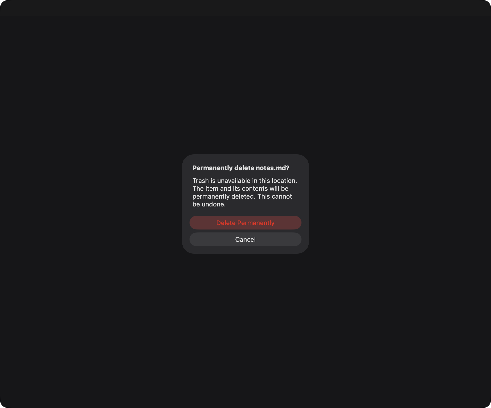

# Trash-unavailable deletion validation

Issue: [#268](https://github.com/PinedaTec-EU/LeonardoMD/issues/268). PR: [#269](https://github.com/PinedaTec-EU/LeonardoMD/pull/269).

Captured 2026-10-23, Europe/Madrid, in native AppKit sheets driven by the production AppSession tree-deletion flow through XCTest. Synthetic notes.md and isolated temporary projects; no user files or filesystem defaults changed. The FileManager test adapter injects unsupported-Trash responses; it uses real removal only after the production confirmation accepts. No browser is involved. Window viewport: 1000×832 points, 2000×1664 compositor pixels, dark appearance, English and Spanish. The capture includes the test owner window behind the warning.

The warning and both actions are readable without clipping. Cancel remains the first/default response in the alert contract; permanent deletion is explicitly marked destructive. macOS controls the visual action arrangement. These are real compositor captures, rather than image-generated evidence. The adjacent source-hashes.json binds the tested production sources and test harness to their bytes; it can be compared against the reviewed head after the evidence and ledger commit.

Validation:

- Focused `swift test --filter 'Trash|StaleFileOperationTests'`: 15 XCTest cases passed, covering recoverable deletion, failure preservation, unsupported preflight, late confirmation, cancellation, session change, renewed authorization and permanent-deletion containment/symlink guards.
- Full `swift test`: passed, including opt-in captures through `LEONARDO_TRASH_CAPTURE_DIR=/tmp/leonardo-268-captures`. Existing opt-in/skipped tests retain their normal conditions.
- Two successful compiler-bearing invocations recorded in deploy/version/entries/269.yaml. An initial failed compilation of the test observation fixture was corrected and does not increment the ledger.

Limits: the exact filesystem type and runtime error on the owner's reported volume remain unknown. This verifies injected unsupported responses and ordinary local Trash behavior, not every external or network volume. Only explicit Cocoa featureUnsupported and POSIX ENOTSUP/EOPNOTSUPP establish unavailable Trash; unknown errors preserve the original file. Missing Trash folders alone are indeterminate. Project-wide deletion remains Trash-only. This does not establish packaged-product startup or a fresh first-window check; no standalone XCTest GUI bundle was created.

To repeat native capture, set LEONARDO_TRASH_CAPTURE_DIR to an absolute disposable directory and invoke the repository compilation recorder for the current source PR with swift test --filter TrashUnavailableConfirmationTests. Screen Recording permission is needed only for the opt-in screencapture path; ordinary tests do not require it.
